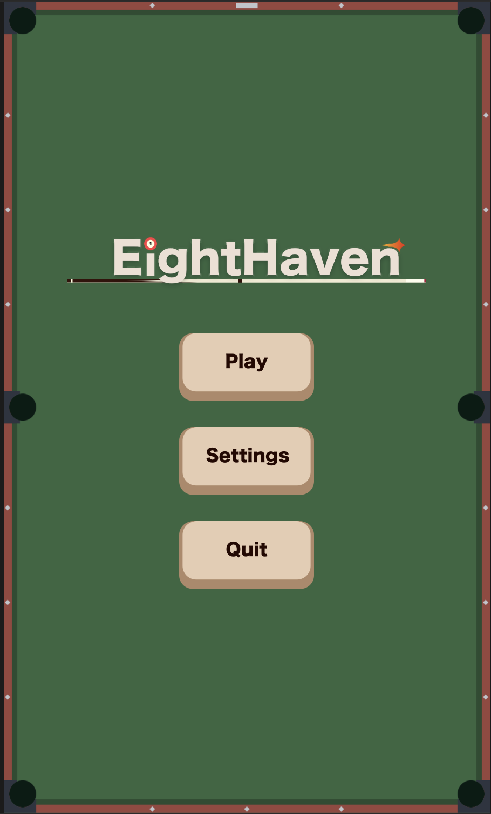

# EightHaven
A bouncy 8 ball game made for the Hack Club Haven Game Jam. This game includes special functionalites to make the normal 8 ball game more interesting.

---

## Demo
You can try it on Itch.io: [https://yukeey.itch.io/eighthaven](https://yukeey.itch.io/eighthaven)

---

## Examples

---

## Deploy

1. Open the project in Godot 4.7.X
2. Click Project -> Export
3. Click "Add..."
4. Click Web
5. Click "Manage Export Templates" (skip if you already have them installed)
	1. Click "Download and Install"
	2. Click "Close" once the download has finished
6. Reopen Project -> Export
5. Click "Export Project..."

